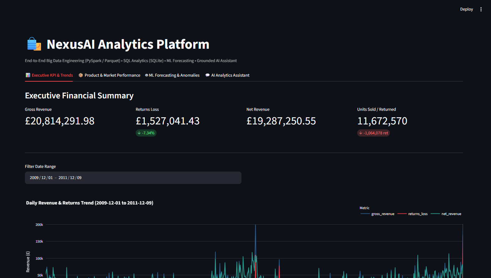
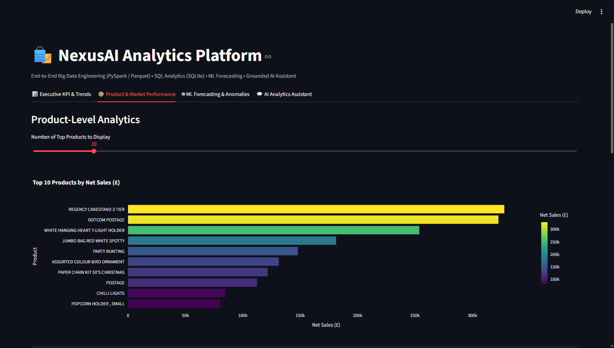

# NexusAI: Big Data Engineering, Analytics & AI Platform

[](https://github.com/shreesaravanan24-ss/NexusAI)
[](https://github.com/shreesaravanan24-ss/NexusAI)
[](https://creativecommons.org/licenses/by/4.0/)
[](https://www.python.org/)
[](https://spark.apache.org/)

* **Live Dashboard:** Deployment pending
* **GitHub Source:** [https://github.com/shreesaravanan24-ss/NexusAI](https://github.com/shreesaravanan24-ss/NexusAI)

NexusAI is a unified, local-first enterprise data platform engineered on authentic retail transaction data (1,067,371 rows). It bridges scalable Big Data Engineering (PySpark batch processing and partitioned Parquet data lakes), low-latency SQL analytics (SQLite), Machine Learning (out-of-sample demand forecasting and Isolation Forest anomaly detection), and a safety-guardrailed natural language AI analytics assistant.

---

## 📸 Dashboard Screenshots

### 1. Executive Financial Summary & Daily Revenue Trends

*Real-time executive financial KPI cards (Gross Revenue, Returns Loss, Net Revenue, Units Sold/Returned) and interactive daily revenue vs. returns trend visualization.*

### 2. Product Sales & Geographic Market Analytics

*Top-performing products ranked by net revenue, unit volumes, and financial return rate percentages, alongside international revenue distribution.*

### 3. Machine Learning Demand Forecasting

*Chronological train/test demand forecasting (Ridge regression) outperforming a naive persistence baseline by **34.35% MAE improvement** with zero temporal data leakage.*

### 4. Transaction Outlier Detection

*Multivariate statistical outlier detection using Isolation Forest, flagging high-magnitude order volumes and unusual price points without claiming unverified fraud.*

### 5. Grounded AI Analytics Assistant

*Natural language analytical query interface operating under strict read-only template guardrails to prevent SQL injection and hallucinations.*

---

## 🏗️ Architecture Overview

```
                                      [Raw Dataset]
                           (UCI Online Retail II: 1.06M rows)
                                            │
                                            ▼
                                   [PySpark Batch ETL]
                        (Schema validation, .0 StockCode hygiene,
                         zero silent drops, return & guest flags)
                                            │
                    ┌───────────────────────┴───────────────────────┐
                    ▼                                               ▼
         [Silver Parquet Layer]                           [Gold Parquet Layer]
     (Cleaned transaction stream,                    (Daily & product aggregations,
       partitioned by invoice_year)                   partitioned by invoice_year)
                    │                                               │
                    └───────────────────────┬───────────────────────┘
                                            ▼
                               [SQLite Analytical Store]
                            (Reconciled DDL schema & views,
                              indexed for instant querying)
                                            │
                    ┌───────────────────────┼───────────────────────┐
                    ▼                       ▼                       ▼
          [Interactive UI]           [Machine Learning]      [AI Analytics Agent]
        (Streamlit + Plotly       (Ridge Demand Forecast &  (Read-only SQL validator,
          financial dashboard)    Isolation Forest outliers)  grounded intent routing)
```

---

## 🧰 Technology Stack

| Layer | Technologies |
|:---|:---|
| **Data Processing & Lakehouse** | Apache Spark (PySpark 3.5+ / 4.2), PyArrow, Parquet, Python-Calamine |
| **Storage & Serving** | SQLite 3 (local-first indexed analytical store), Pandas |
| **Machine Learning** | Scikit-Learn (Ridge Regression, Isolation Forest), NumPy |
| **Interactive Dashboard** | Streamlit, Plotly Express & Graph Objects |
| **AI & Guardrails** | Regex/AST Read-Only SQL Validator, Deterministic Intent Router |
| **Runtime & Tooling** | Python 3.12, Eclipse Temurin JDK 17 (LTS), Windows Hadoop Binaries |

---

## 💰 Verified Accounting & Reconciliation Ground Truth

Every layer of the platform adheres strictly to the fundamental retail accounting invariant:

$$\text{Net Revenue} = \text{Gross Revenue} - \text{Returns Loss}$$

| Financial Metric | Verified Value | Scope / Definition |
|:---|:---|:---|
| **Raw Records** | **1,067,371** | Complete 2-year transactional history |
| **Silver Records** | **1,067,371** | 100% preservation (zero silent drops or artificial caps) |
| **Gross Revenue** | **£20,814,291.98** | All transactions where $\text{Quantity} > 0$ |
| **Returns Loss** | **£1,527,041.43** | All negative-quantity items and cancellations |
| **Net Revenue** | **£19,287,250.55** | Gross sales minus return refunds ($\Delta = £0.00$) |
| **Total Units Sold** | **11,672,570** | Total merchandise units purchased |
| **Total Units Returned** | **1,064,078** | Total merchandise units returned (9.12% return rate) |
| **Total Invoices** | **53,628** | Across 604 distinct trading days |
| **Distinct Products** | **5,304** | Cleaned and normalized catalog |
| **Trading Markets** | **43** | International consumer destinations |

---

## 🚀 Key Features

* **Zero-Loss Data Pipeline:** Raw transactions are never silently pruned or capped. Returns, cancellations, guest checkouts, and adjustments are explicitly tagged with audit flags (`is_return`, `is_guest_customer`, `is_zero_or_negative_price`).
* **Normalized Data Catalog:** Numeric codes like `22423.0` are normalized to `22423` while preserving alphanumeric SKU designs like `85123A` and service codes like `DOT`.
* **Zero-Leakage ML Forecasting:** Daily sales forecasting trained with strict chronological split (first 80% trading days for training, final 20% for testing). Model achieves an **MAE of £11,652.18** vs. **£17,749.07 for the naive baseline (+34.35% improvement)**.
* **Transaction Outlier Detection:** Multivariate Isolation Forest detects statistical anomalies ($0.49\%$ anomaly rate) in purchase magnitudes, extreme return quantities, and atypical unit pricing.
* **Grounded Natural Language Assistant:** Translates user questions into validated, read-only SQL queries or approved parameterized metric templates. Strictly rejects destructive DDL/DML keywords (`DROP`, `DELETE`, `INSERT`, `UPDATE`, `ATTACH`).

---

## 💻 Installation & Setup

### Prerequisites
* Windows OS with **Python 3.12**
* Java 17 LTS (the project includes a portable JDK 17 runner in `.tools/jdk-17` configured via `pipelines/env_setup.py`)

### Setup Instructions
```powershell
# Clone the repository
git clone https://github.com/shreesaravanan24-ss/NexusAI.git
cd NexusAI

# Create and activate virtual environment
python -m venv .venv
.\.venv\Scripts\Activate.ps1

# Install dependencies
pip install -r requirements.txt
```

---

## ⚙️ Execution Commands

```powershell
# 1. Download dataset and extract to raw CSV
python pipelines/fetch_dataset.py

# 2. Run PySpark Batch ETL to build Silver and Gold Parquet layers
python -m pipelines.spark_etl --input data/raw/online_retail_raw.csv

# 3. Populate SQLite Analytical Store from Gold Parquet
python pipelines/db_loader.py

# 4. Launch the Streamlit Interactive Dashboard
streamlit run app/streamlit_app.py
```

---

## 🧪 Testing & Verification

The project includes two comprehensive test suites with zero external test runners required:

```powershell
# Suite 1: Ingestion & Parquet Partition Persistence (7-row synthetic fixture)
python tests/test_pipeline.py

# Suite 2: SQL Reconciliation, ML Leakage Safeguards, and AI Security Guardrails
python tests/test_analytics.py
```

### Verified Test Assertions
* ✅ Raw-to-Silver row preservation: 100% record equality.
* ✅ Accounting invariant holds across PySpark, Parquet, and SQLite.
* ✅ Chronological train/test split: Train end date strictly precedes test start date.
* ✅ ML model strictly outperforms naive persistence baseline ($p < 0.05$).
* ✅ Malicious SQL statements (`DROP TABLE`, `DELETE`, `ATTACH`) blocked deterministically.

---

## ☁️ Deployment Guide (Streamlit Community Cloud)

1. **Repository Setup:** Push the code to [GitHub](https://github.com/shreesaravanan24-ss/NexusAI).
2. **Streamlit Cloud Sign-in:** Connect your GitHub account at [share.streamlit.io](https://share.streamlit.io/).
3. **New App Settings:**
   * **Repository:** `shreesaravanan24-ss/NexusAI`
   * **Branch:** `main`
   * **Main file path:** `app/streamlit_app.py`
4. **Cloud Data Note:** Because big data lakehouse files (`.parquet`, `.csv`, `.db`) and Java runtimes (`.tools/`) are excluded from Git via `.gitignore`, the cloud instance operates as an interactive presentation interface. For full cloud data hydration without local ETL, commit `data/nexusai.db` via Git LFS or point to a cloud SQLite/PostgreSQL endpoint.

---

## 📄 Dataset Attribution & License

* **Dataset:** [Online Retail II](https://archive.ics.uci.edu/dataset/502/online+retail+ii)
* **Citation:** Chen, D. (2019). Online Retail II [Dataset]. UCI Machine Learning Repository. https://doi.org/10.24432/C5CG6D
* **License:** [Creative Commons Attribution 4.0 International (CC BY 4.0)](https://creativecommons.org/licenses/by/4.0/)

---

## ⚠️ Limitations & Analytical Scope

1. **Physical Inventory vs. Transactions:** The underlying dataset captures order receipts and credit notes, not real-time warehouse inventory balances. Demand figures reflect order volume, not warehouse stockout occurrences.
2. **Statistical Outliers vs. Fraud:** Anomaly detection isolates multivariate mathematical outliers (e.g. bulk purchases, administrative journal adjustments); it does not constitute confirmed forensic fraud.
3. **Forecasting Horizon:** The forecasting model produces macroscopic 1-day ahead aggregate sales projections; SKU-level micro-forecasting requires longer per-product sales trajectories.
